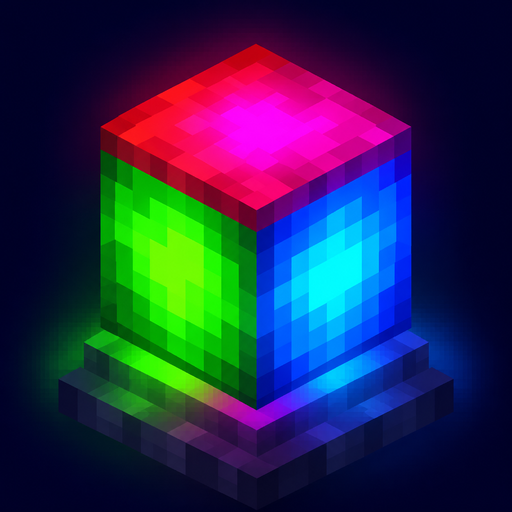
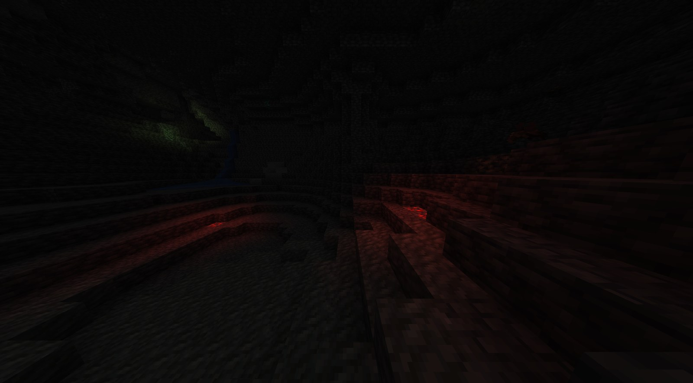
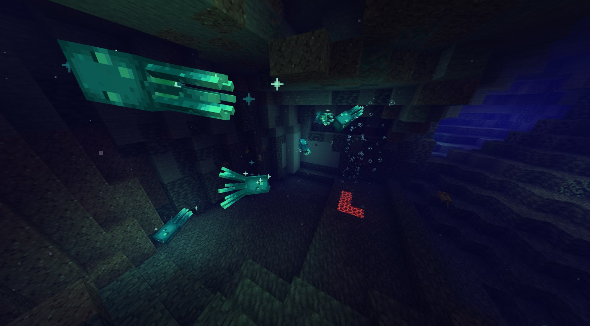
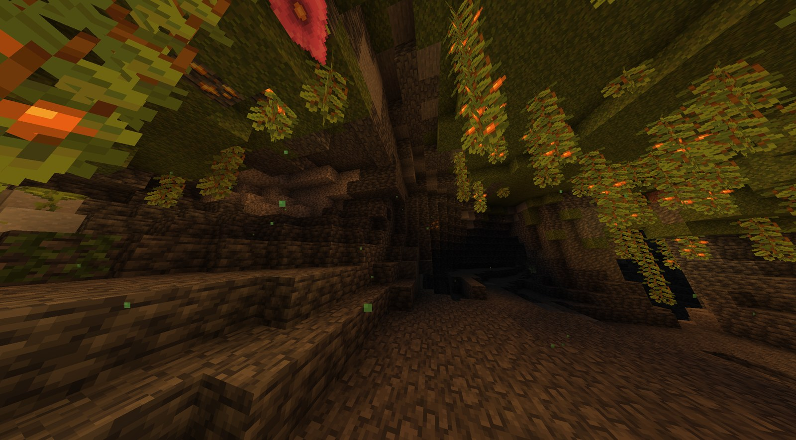
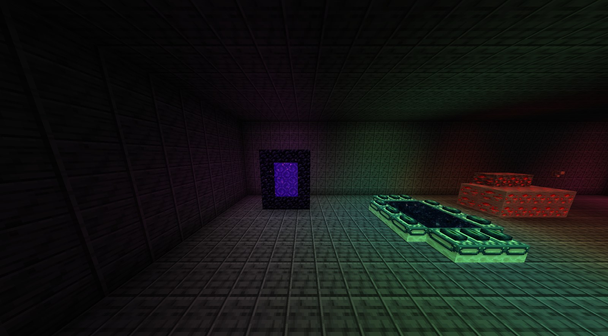

<div align="center">



# ChromaLight

**Colored block light for Minecraft 1.21.1 on NeoForge**

[](https://modrinth.com/mod/chromalight)
[](https://www.curseforge.com/minecraft/mc-mods/chromalight)
[](https://github.com/notsoboreal/ChromaLight/issues)


</div>

Torches glow warm, soul fire glows blue, amethyst glows purple, and light from
different sources mixes where it overlaps. Brightness, light levels and mob spawning
stay vanilla. ChromaLight only changes the color, and it works on any server.

<p align="center">
  
  
  
  
</p>

## Features

- Colors for every vanilla light source, mixed smoothly across the whole render distance.
- Mobs, players, items, particles, chests, signs and banners take the color of the light around them.
- Sky light follows the time of day and the weather: warm daylight, orange sunsets,
  blue moonlight, grey rain.
- Optional fire flicker for torches, campfires, candles and lanterns.
- Works with the vanilla renderer and Sodium 0.8.13, plus LambDynamicLights,
  Ars Nouveau and the usual performance mods. See [Mod support](#mod-support).
- Light packs: color blocks from any mod with a small JSON file. Light sources
  without a rule get a color from their texture automatically.

## Requirements

- Minecraft 1.21.1, Java 21, NeoForge 21.1.235 or newer (21.1.x).
- Optional: **Sodium 0.8.13** for NeoForge. Other Sodium versions are not supported.
- Optional: Iris 1.8.14 for shader packs (see [Limitations](#limitations)).
- Install on the client only. Servers don't need it, and it works on any server.

## Settings

All settings are on the **ChromaLight** page of Sodium's video settings (Reese's
Sodium Options works too). Without Sodium, edit `config/chromalight.properties` and
restart the game.

| Page | Setting | Default | What it does |
| --- | --- | --- | --- |
| Lighting | Enable ChromaLight | On | Master switch |
| Lighting | Color strength | 85% | How strongly lights tint the world |
| Lighting | Source blending | 100% | Mixes light from nearby sources. 0% is faster: each spot takes the color of its brightest source |
| Lighting | Automatic colors | On | Light sources without a color rule get one from their texture |
| Sky | Sky light color | On | Warm daylight, orange sunrise and sunset, blue moonlight |
| Sky | Sky color strength | 60% | How strongly time of day and weather tint sky light |
| Sky | Weather colors | On | Grey-blue sky light in rain, darker in thunderstorms |
| Fire flicker | Fire flicker | Off | Torches, fire, campfires, candles and lanterns flicker |
| Fire flicker | Flicker strength | 50% | How deep the flicker dips |
| Entities | Colored light on entities | On | Mobs, players, items, particles and block entities (chests, signs, banners) take the color of the light around them |
| Entities | Color dynamic lights | On | Colors LambDynamicLights / Ars Nouveau dynamic light |
| Performance | Mixed sources per voxel | 4 | How many colors can mix at one spot (2-8) |
| Performance | Realtime channels per section | 32 | How many animated colors one chunk section can show (0-32) |

Sky colors are `sky_day`, `sky_dusk`, `sky_night`, `sky_rain` and `sky_thunder` in the
config, or set them in game with `/chromalight sky`. Sky light keeps its vanilla
brightness; only its color changes.

Source blending is the setting that affects performance most. If chunk loading
feels slow, lower it first.

## Commands

Client commands; they don't change the world. Source, type and blood moon changes
reset when you leave the world; sky colors are saved to the config.

```text
/chromalight enable | disable
/chromalight stats                       performance counters
/chromalight debug                       what ChromaLight sees for the block you look at
/chromalight source baked|realtime RRGGBB   recolor the light you look at
/chromalight source rainbow [seconds]
/chromalight source clear
/chromalight type realtime RRGGBB        recolor every block of that type
/chromalight type rainbow [seconds]
/chromalight type clear
/chromalight sky                         show sky light colors
/chromalight sky day|dusk|night|rain|thunder RRGGBB
/chromalight sky reset
/chromalight bloodmoon [on|off]          red moon, sky, fog and moonlight (just for fun)
/chromalight pack                        light pack screen
/chromalight pack list|none|reload|folder
```

## Light packs

A light pack is a set of JSON color files. There are two ways to install one:

- **The `chromalight` folder** in the game directory. Each pack is a folder or .zip;
  every `*.json` inside is read, `pack.mcmeta` and `pack.png` are optional. Turn packs on
  under **Video Settings > ChromaLight > Light packs** (also the Config button in the mod
  list, or `/chromalight pack`). It is Minecraft's resource pack screen: several packs
  at once, the higher one wins, drag and drop works. Edits to an active pack apply within
  a second, no reload needed. The folder comes with a "Cold fire" example.
- **Any resource pack**, as `assets/<namespace>/chromalight/lights/*.json`. See
  [examples/light-pack](examples/light-pack).

The file format is the same for both:

```json
{
  "blocks":   { "mymod:lamp": "#FF8800", "mymod:rgb_lamp[color=red]": "#FF2020", "#mymod:crystals": "#90C8FF" },
  "flicker":  [ "mymod:brazier", "#mymod:fire_bowls" ],
  "items":    { "mymod:glow_wand": "#80FFFF" },
  "entities": { "mymod:fire_spirit": "#FF8040" },
  "entity_blacklist": [ "somebossmod:*", "othermod:the_boss" ]
}
```

- `blocks`: a block id, a block id with state properties, or a `#tag`. Ids from mods
  that aren't installed are ignored.
- `flicker`: blocks that flicker when Fire flicker is on.
- `items`, `entities`: colors for dynamic light sources (held, dropped or glowing).
  Block items such as torches use their block's color automatically.
- `entity_blacklist`: entity types that are never tinted (`modid:*`, `modid:name`, `#tag`).

Priority, lowest first: bundled colors, resource packs, packs from the `chromalight`
folder, then colors you changed in `config/chromalight.properties`. F3+T reloads
resource packs.

Light sources that no rule covers, usually blocks from other mods, get a color from
their texture: its strongest hue, weighted toward bright and colorful pixels, which is
normally the glowing part. A texture with two colors takes the main one, not a mix of
both. Grey and white textures stay uncolored. Glowing entities without a rule (dynamic
lights) are colored from their own texture the same way. **Automatic colors** turns this off.

The default colors of vanilla blocks are listed in [PALETTE.md](PALETTE.md).

## Mod support

- **Sodium 0.8.13**: full support, with its own settings page.
- **LambDynamicLights**: held torches, burning mobs, glowing items and other dynamic
  lights color the world.
- **Ars Nouveau**: light spells, sconces and magelight torches use the color picked in
  Spell Styles, rainbow included. Spell projectiles light the world in their trail color.
  Ars Nouveau's own dynamic light (`/ars-light on`) is supported as well.
- **Sodium addons**: Sodium Extra, Chloride, Sodium Shadowy Path Blocks and Reese's Sodium
  Options work alongside. Sodium Extra's fog shapes and ChromaLight patch different lines
  of Sodium's terrain shader; Chloride's True Darkness darkens the lightmap after the sky
  color is applied. Addons made for Sodium 0.6 don't work with Sodium 0.8.13: Sodium
  Leaf Culling 1.0.1, for example, crashes when a world loads, with or without ChromaLight.
- **Performance mods**: Lithium, FerriteCore, ModernFix, ImmediatelyFast, Entity Culling.
- **Chunk and light engines**: C2ME with ScalableLux (the Starlight fork for 1.21), or
  Moonrise. ChromaLight reads block light through the vanilla light API, which they keep.
  Starlight itself has no 1.21 version.
- Some bosses and special mobs look wrong when tinted. Add them to `entity_blacklist`
  in the config or in a light pack, e.g. `entity_blacklist=cataclysm:*`. The list is
  empty by default.

## For mod developers

Client-side API, call it on the client thread:

```java
import dev.nightmode.chromalight.api.ClientLightSources;

ClientLightSources.set(pos, 0xFF0040, ClientLightSources.Mode.BAKED);    // one block, rebuilds its area
ClientLightSources.set(pos, 0x00AAFF, ClientLightSources.Mode.REALTIME); // one block, changes without rebuilds
ClientLightSources.setType(block, 0x00AAFF);                             // every block of a type
ClientLightSources.registerColorProvider(block, provider);               // color from block entity data
ClientLightSources.remove(pos);
ClientLightSources.removeType(block);
```

The API only recolors light that a block already emits. It doesn't create light or
sync anything with the server.

## Limitations

- **Shader packs**: ChromaLight runs alongside Iris, but most packs replace terrain
  lighting with their own, so colors may not show or may look off. Use
  `/chromalight disable` if a pack looks wrong.
- Colors are computed while chunks build. Source blending makes chunk building
  slower in brightly lit areas; frame rate after that is unaffected.
- With Sodium, each terrain vertex takes 4 more bytes (from 20 to 24), so terrain uses about
  20% more video memory.

## Building

```powershell
.\gradlew.bat build              # mod JAR in build/libs/
.\run-client-jfr.ps1             # dev client with Sodium, Iris and a JFR recording
.\run-client-jfr.ps1 -Compat     # also LambDynamicLights, Ars Nouveau, Sodium addons,
                                 # performance mods, C2ME and ScalableLux
.\run-client-jfr.ps1 -Compat -PdevChunks=moonrise   # Moonrise instead (or none)
.\run-client-jfr.ps1 -NoIris     # or -NoSodium
```

JFR recordings are saved to `build/jfr/` when the game closes. Gradle is set up for a
local proxy on `127.0.0.1:1080`; remove those lines from `gradle.properties` if you
don't use one.

## License

ChromaLight is **not** open source. The code is public so you can read it, report
bugs and send fixes. You can use the mod, put it in modpacks (downloaded from
Modrinth or CurseForge) and write add-ons against its API. Copying its code or
assets into other projects, publishing forks or ports, and reuploading the files
need written permission. Full terms are in [LICENSE](LICENSE). To ask, open an
[issue](https://github.com/notsoboreal/ChromaLight/issues).
